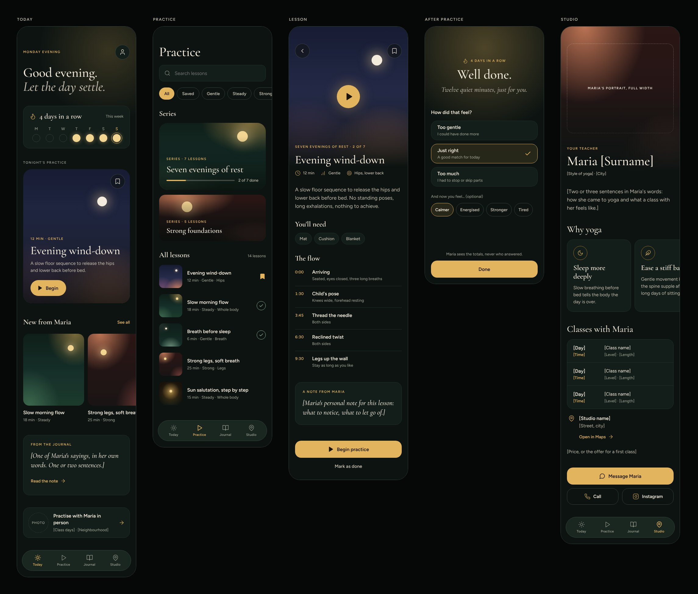

# Yoga with Maria

An Android app where Maria, a yoga teacher, shares lessons, videos, tips and notes, free for anyone, and presents her in-person classes. Working title; not built yet.

**Where things stand (16 Nov 2026):** this repository holds the blueprint. A builder (Claude Code) turns it into the app, one phase at a time.

| If you want to… | Read |
|---|---|
| Understand how it all fits together | [`docs/START-HERE.md`](docs/START-HERE.md) |
| Know who does what, start a phase, see the decisions | [`docs/PLAN.md`](docs/PLAN.md) |
| See what the app will look like | [`docs/design/mockups.jpg`](docs/design/mockups.jpg) |
| Set up the accounts | [`docs/OWNER-SETUP.md`](docs/OWNER-SETUP.md) |
| Add a lesson, a tip or a photo | [`docs/ADDING-CONTENT.md`](docs/ADDING-CONTENT.md) |
| Publish on Google Play | [`docs/PLAY-STORE.md`](docs/PLAY-STORE.md) |

For the builder: start with [`CLAUDE.md`](CLAUDE.md).

No ads, no tracking, no accounts. Lesson texts and photos in `content/` belong to Maria.
